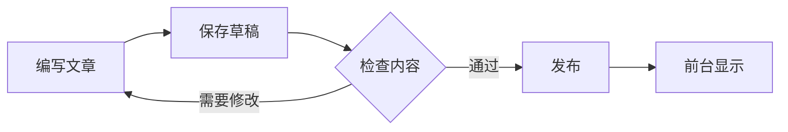
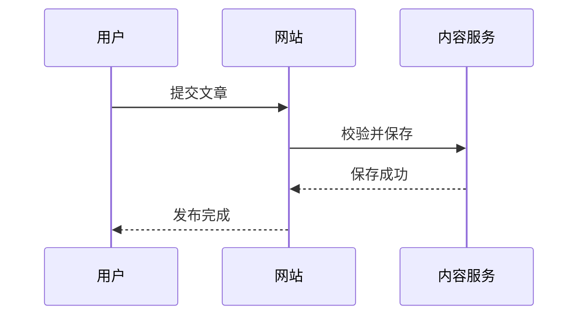
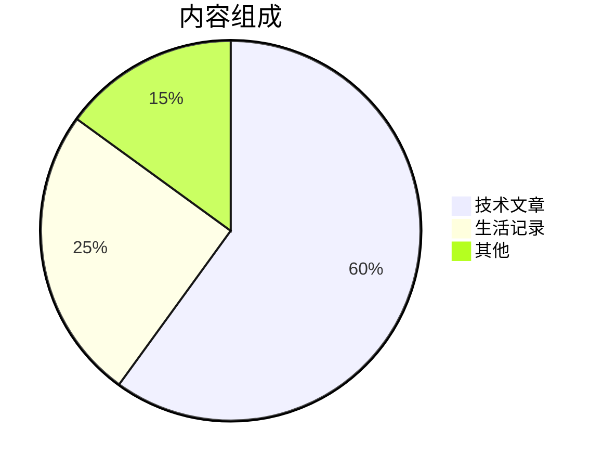

# Markdown 综合测试文档

把本文复制到后台的 **Markdown 正文**，另填标题后保存草稿或发布。先保持 Markdown 模式，用前台文章页检查效果；富文本模式的转换结果需要另行核对。

当前渲染器使用 GFM、KaTeX、代码高亮和 HTML 清理。Mermaid、ECharts、PlantUML 暂未接入，因此下方图表代码显示为代码块是当前预期行为。

## 1. 标题与段落

### 三级标题

#### 四级标题

##### 五级标题

###### 六级标题

这是第一段，含有 **粗体**、*斜体*、***粗斜体***、~~删除线~~ 和 `行内代码`。

这是第二段。两个段落之间留一个空行。

这是需要换行的一行。  
这一行应紧跟在下一行显示，而不是接在上一行末尾。

---

## 2. 无序列表与嵌套

- 第一项
- 第二项
  - 二级项目 A
  - 二级项目 B
    - 三级项目
- 第三项包含 **强调** 和 $x^2$。

## 3. 有序列表

1. 创建文章。
2. 编写正文。
   1. 插入代码。
   2. 插入公式。
3. 保存草稿。
4. 发布并检查前台。

列表中的多段落内容：

1. 第一项的第一段。

   第一项的第二段，缩进保持在同一个列表项内。

2. 第二项。

## 4. 任务列表

- [x] 普通 Markdown
- [x] 数学公式
- [ ] 检查手机显示
- [ ] 接入图表引擎
  - [x] 准备 Mermaid 测试
  - [ ] 实现前台图表渲染

预期：显示勾选框；前台复选框是展示用途，不能用于保存任务状态。

## 5. 引用

> 一级引用。
>
> 引用中的第二段，含有 **粗体**。
>
> > 二级引用。

> [!NOTE]
> 这是 GitHub 风格提示框测试。当前预计显示普通引用和文字，不会自动变成专门的提示卡片。

## 6. 表格及对齐

| 模块 | 语法示例 | 结果 |
| :--- | :---: | ---: |
| 粗体 | `**text**` | 支持 |
| 行内数学 | `$E=mc^2$` | 支持 |
| Mermaid 图 | `mermaid` 代码块 | 暂不绘图 |
| 分隔符 | `A\|B` | 竖线正常显示 |

第一列左对齐，第二列居中，第三列右对齐。

| 参数 | 数值 | 单位 |
| --- | ---: | --- |
| 温度 $T$ | 300 | K |
| 时间步长 $\Delta t$ | 0.002 | ps |
| 原子数 $N$ | 125000 | 个 |

手机端重点检查：宽表格是否可阅读，是否把整页撑出屏幕。

## 7. 行内数学公式

质量能量关系：$E=mc^2$。

希腊字母、上下标：$\alpha + \beta = \gamma$，$x_i^2$，$\Delta G$。

分数、根号与向量：$\frac{a}{b}$，$\sqrt{x^2+y^2}$，$\vec{F}=m\vec{a}$。

公式前后混合中文：当 $T=300\,\mathrm{K}$ 时，系统能量为 $U$。

## 8. 独立数学公式

### 积分与求和

$$
\int_0^\infty e^{-x^2}\,dx = \frac{\sqrt{\pi}}{2}
$$

$$
\sum_{i=1}^{n} i = \frac{n(n+1)}{2}
$$

### 多行对齐

$$
\begin{aligned}
E &= K + U \\
K &= \frac{1}{2}mv^2 \\
F &= -\nabla U
\end{aligned}
$$

### 矩阵

$$
A=\begin{pmatrix}
1 & 2 & 3 \\
4 & 5 & 6 \\
7 & 8 & 9
\end{pmatrix}
$$

### 分段函数

$$
f(x)=\begin{cases}
x^2, & x\ge 0 \\
-x, & x<0
\end{cases}
$$

### 分子动力学示例

$$
U_{\mathrm{LJ}}(r)=4\varepsilon\left[\left(\frac{\sigma}{r}\right)^{12}-\left(\frac{\sigma}{r}\right)^6\right]
$$

预期：上述公式均应显示成排版后的数学，而不是原始美元符号；长公式重点检查手机端。KaTeX 并不等于完整 LaTeX，额外宏包和自定义宏未自动加载。

## 9. 代码块与高亮

```python
def mean(values: list[float]) -> float:
    # 中文注释应正常显示
    return sum(values) / len(values)

print(mean([1.0, 2.0, 3.0]))
```

```javascript
const article = { title: 'Markdown 测试', published: true };
console.log(article.title);
```

```bash
python -m pytest tests/backend -q
```

```json
{
  "title": "测试文档",
  "tags": ["Markdown", "公式"],
  "published": false
}
```

```text
没有指定编程语言的普通文本。
**这里不应变成粗体**
$这里不应变成数学公式$
```

预期：常见语言代码有高亮，普通文本代码块保留字面内容。

## 10. 链接与图片

[网站首页](http://8.133.165.170:8080/)

自动链接测试：https://example.com

引用式链接：[示例页面][example]

[example]: https://example.com "示例链接标题"

站内静态图片测试：


实际上传测试时，可把上面的图片地址换成后台生成的 `/uploads/文件名.png`。Markdown 图片使用的是图片展示；SVG 图片的支持不代表支持直接执行内联 SVG 或图表脚本。

## 11. 脚注

这是带脚注的说明[^note]，这是另一处说明[^second]。

[^note]: 第一条脚注，可检查编号链接和返回正文的链接。
[^second]: 第二条脚注，包含 **粗体** 和 $x^2$。

## 12. 安全 HTML

<details>
<summary>点击展开详细内容</summary>

折叠内容中有 **Markdown 粗体** 和普通说明。

</details>

上标：x<sup>2</sup>。下标：H<sub>2</sub>O。

显式换行：第一行<br>第二行。

<span style="color:red">内联样式测试：颜色样式可能被清理，应保留文本。</span>

预期：允许的 HTML 标签显示正常，任意样式和危险属性不保证保留；不支持在文章中运行 JavaScript 或任意 iframe。

## 13. 图表测试：当前显示源码

### Mermaid 流程图



### Mermaid 时序图



### Mermaid 饼图



### ECharts 配置

```echarts
{
  "title": { "text": "文章阅读量" },
  "xAxis": { "type": "category", "data": ["周一", "周二", "周三"] },
  "yAxis": { "type": "value" },
  "series": [{ "type": "bar", "data": [12, 25, 18] }]
}
```

预期：以上四个块目前显示源码，不会产生图形。若需要立即展示图表，可以先导出 PNG/SVG 图片，再通过图片语法插入文章。

## 14. 转义与不支持的扩展

转义星号：\*这不是斜体\*。

字面美元符号：`$100`。

定义列表测试（当前不保证支持）：

Markdown
: 一种轻量标记语言。

目录指令测试（当前没有此语法）：

[TOC]

文章页面已有自己的侧边目录机制；`[TOC]` 不会自动生成目录。标题含标点、重复标题、代码块内的井号，可用于进一步检查侧边目录跳转是否准确。

## 15. 验收清单

- [ ] 标题、粗体、删除线、换行正常。
- [ ] 多级列表、有序列表、任务框正常。
- [ ] 表格及列对齐正常，手机宽表格可阅读。
- [ ] 行内、独立、矩阵、分段和多行公式正常。
- [ ] 代码高亮正常，代码中的 Markdown 不被执行。
- [ ] 图片、链接、脚注和折叠块正常。
- [ ] Mermaid/ECharts 当前显示源码，未误认为已支持绘图。
- [ ] Markdown 转富文本再转回来后，逐项比较内容有无丢失。
